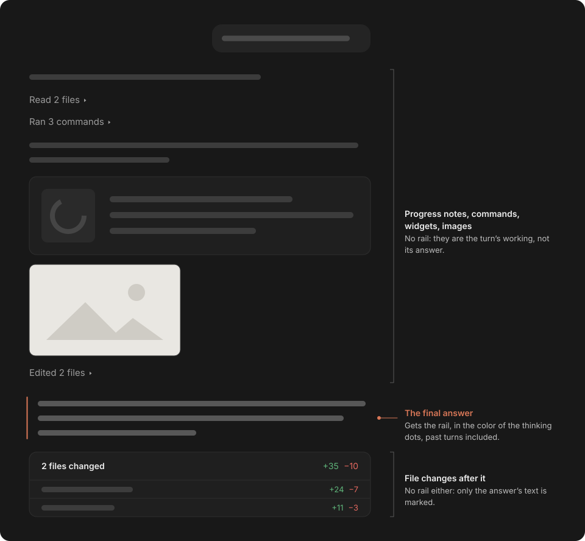
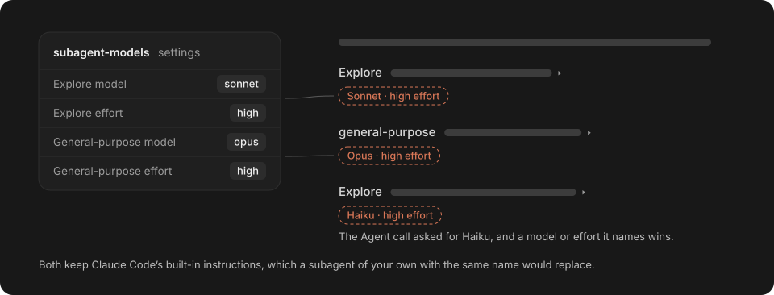

# Claude Desktop Mods

Mods for the Code tab of the Claude desktop app: Claude Code plugins that change what the app draws or how a session behaves, without touching the app itself. Each installs on its own, and none sends anything off your machine.

They're made to share, so clone them and have your Claude customize them to how you work.


The orange rail marks the final answer (`answer-indicator`); the line under it and the footer's Total are `Total`'s figures.

## Mods

| Mod | What it does | Works in |
| --- | --- | --- |
| [`answer-indicator`](#answer-indicator) | Marks each turn's final answer with an orange rail | Desktop app |
| [`Total`](#total) | Shows each turn's time, tokens, speed and cost, and the session's sum | Desktop app; the terminal shows the sum |
| [`retitle`](#retitle) | Lets the main agent name the session and rename it as the work moves on | Desktop app |
| [`subagent-models`](#subagent-models) | Sets the model and effort of the built-in subagents | Desktop app and terminal |

## Install

```bash
claude plugin marketplace add teron131/claude-desktop-mods
```

```bash
claude plugin install answer-indicator@claude-desktop-mods
claude plugin install Total@claude-desktop-mods
claude plugin install retitle@claude-desktop-mods
claude plugin install subagent-models@claude-desktop-mods
```

`subagent-models` asks for its model and effort options on install.

`answer-indicator` and `Total` read past turns with ripgrep: Claude Code's own copy on macOS and Linux, an installed `rg` on Windows.

## answer-indicator

Draws an orange rail, in the thinking dots' color, beside each turn's final answer, past turns included. Only the answer's text is marked; progress notes, commands, widgets, images and file changes are not.



## Total

Writes each turn's figures under its final answer, and the session's sum in the footer.


- Tokens and speed count only the main conversation; the cost is Claude Code's own `/cost` figure, subagents included, so no prices are fetched.
- Transcripts store only the session's total cost, so `Total` saves each turn's in `~/.claude/total-costs`; turns from before you installed it show none.

On macOS, `Total` also makes sure the session you click on opens at once. The app runs each session you click on in its own process, at most `max(6, RAM ÷ 3 GB)` of them, and keeps idle ones running, so it's usually full, and then a session you click on waits until another has idled a minute.

So `Total` ends the process of a session you've clicked away from, and only if nothing is running in it: no turn, background task, subagent or Remote Control. Nothing is lost: the session stays in your sidebar and reopens from its transcript in a second or two. Clicking through 6 sessions past the limit, one every 5 seconds, all 18 opened at once.

**Limitation:** the app treats a process that ends within 30 seconds of starting as a crash, and after 15 it stops reopening that session until you send it a message. So `Total` ends a young process at most 10 times per session per app run; after that it waits until the process is 35 seconds old, and clicking through more sessions than the limit faster than about every 40 seconds can leave one waiting until your next visit.

## retitle

Gives the session's title to the main agent, so the title follows the work.


- **Why the main agent:** the app's own title is set once from your first message, and a separate titling model would need the whole conversation or drift without it. The main agent already has the session, so a check costs a short note per prompt, plus a rename call when one is due.
- **When:** it names the session before its first reply, then renames it once your last several requests have moved past the title. The whole session would anchor a long one to its start, and the latest message alone would flip on a side question.
- **Form:** 3–6 words in Title Case, subject first, no emoji.
- **No approval card:** `retitle` approves the app's rename card itself.

## subagent-models

Sets the model and effort of Claude Code's [built-in subagents](https://code.claude.com/docs/en/sub-agents#built-in-subagents), `Explore` and `general-purpose`, while keeping their built-in instructions, which a subagent of your own with the same name would replace.



- Your settings apply to every run, even when the main agent's Agent call names another model or effort.
- The options live in settings.json under `pluginConfigs`, and `/config` in a terminal session changes them.
