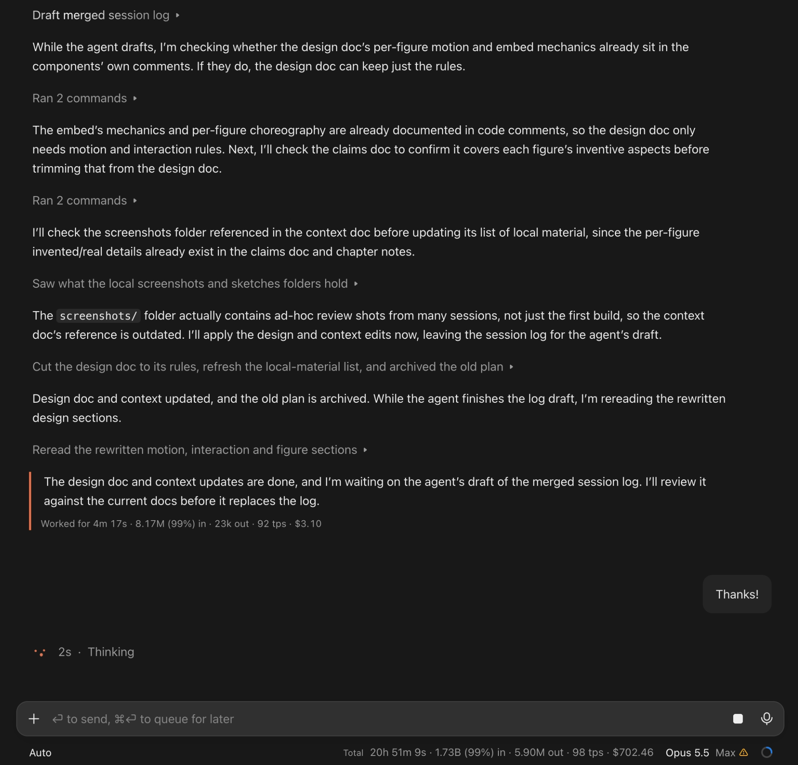
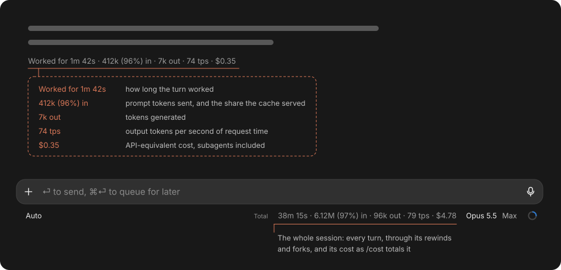
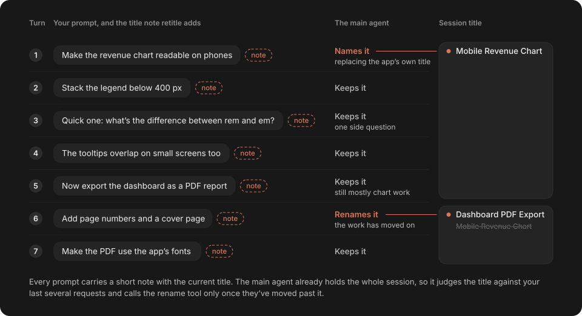
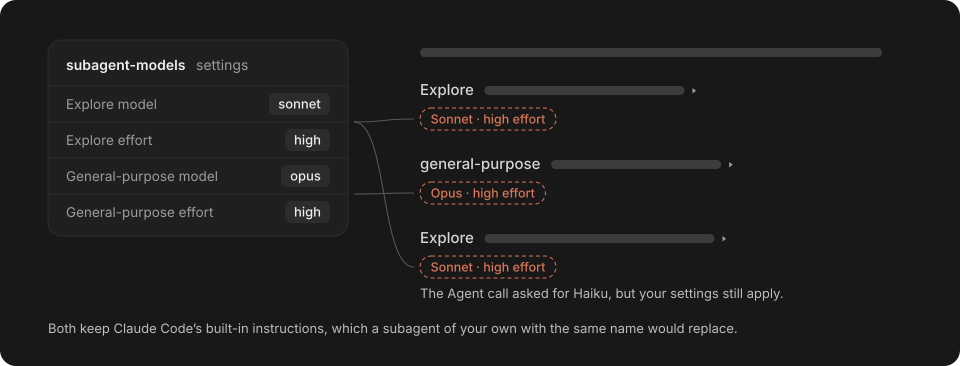

# Claude Desktop Mods

Mods for the Code tab of the Claude desktop app: Claude Code plugins that change what the app draws or how a session behaves, without touching the app itself. Each installs on its own, and none sends anything off your machine.

They're made to share, so clone them and have your Claude customize them to how you work.



The orange rail marks the final answer (`answer-indicator`); the line under it and the footer's Total are `Total`'s figures.

## Install

```bash
claude plugin marketplace add teron131/claude-desktop-mods
```

```bash
claude plugin install answer-indicator@claude-desktop-mods
claude plugin install Total@claude-desktop-mods
claude plugin install retitle@claude-desktop-mods
claude plugin install subagent-models@claude-desktop-mods
```

## Mods

Each mod's README covers what it does, what it reads, writes and runs, and how to install it on its own.

### [answer-indicator](plugins/answer-indicator/README.md)

Marks each turn's final answer with an orange rail. Works in the desktop app.


### [Total](plugins/total/README.md)

Shows each turn's time, tokens, speed and cost, and the session's sum. Works in the desktop app; the terminal shows the sum.



### [retitle](plugins/retitle/README.md)

Lets the main agent name the session and rename it as the work moves on. Works in the desktop app.



### [subagent-models](plugins/subagent-models/README.md)

Sets the model and effort of the built-in subagents. Works in the desktop app and the terminal.


