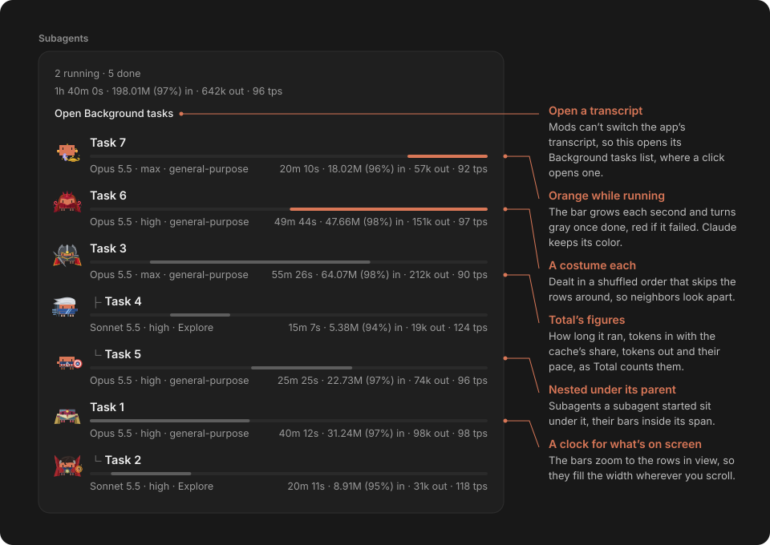
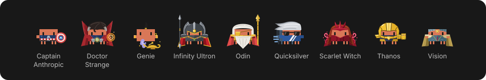

# subagent-view

Lists a session's subagents in a pane as a tree. Each row has the task, a bar for its run, the model, effort and type, and how long it ran, its tokens and its pace.



- **A costume each:** in the desktop app each row's pixel Claude wears one of nine costumes, dealt so neighboring rows look apart, and a row keeps its costume. The terminal shows ●, ✓ or ✗ instead.
- **Status in the bar:** orange while running, gray once done, red if the subagent failed or was stopped.
- **A clock for what's on screen:** the bars zoom to the rows in view, so they fill the width as you scroll. Runs side by side line up, and idle stretches shrink to a small gap.
- **Figures:** counted as `Total` counts a turn: time, tokens in with the cache's share, tokens out and tokens a second. The summary adds them up, counting runs side by side once. Cost is left out, since Claude Code reports it only for the whole session, where `Total` shows it.
- **Effort as sent:** the effort each request carried after every mod changed it, so with `subagent-models` you see that mod's effort.
- **Open a transcript:** in the terminal, `›` on a row opens its transcript and `‹` goes back. In the desktop app, **Open Background tasks** opens the app's list, where a click opens one.
- **The whole session:** subagents from before the mod loaded or before a rewind are read from Claude Code's transcripts.
- **Opening it:** the **Subagents** button under each Agent call in the desktop app, or `/subagents` anywhere.



Works in the Claude desktop app and the terminal, which draws the bars as text.

**Limitations:**

- A forked session lists only its own subagents.
- The desktop app takes no request from a mod to switch its transcript, so a row can't open one there.
- The pane shows the newest 80 subagents, since the desktop app refuses a drawing of over 2,000 elements.

## What it adds and reads

- It adds the `/subagents` command, and in the desktop app a button under each Agent call.
- **Open Background tasks** asks the app, through the view tool it gives each session, to show its Background tasks pane.
- On load it reads the session's subagent transcripts under `~/.claude/projects`, and the desktop app's session records to find those a rewind left, with Claude Code's built-in ripgrep; on Windows, PowerShell finds Claude Code's binary for it.
- It writes no files, and sends nothing off your machine.

## Install

```bash
claude plugin marketplace add teron131/claude-desktop-mods
```

```bash
claude plugin install subagent-view@claude-desktop-mods
```

Part of [Claude Desktop Mods](https://github.com/teron131/claude-desktop-mods), licensed MIT. The robot icon is [Remix Icon](https://remixicon.com)'s `robot-3-line`, under the [Apache License 2.0](https://github.com/Remix-Design/RemixIcon/blob/master/License). The pixel Claude is Claude Code's mascot and the A\ on Captain Anthropic's suit and shield is Anthropic's logo; the costumes are fan nods to Marvel's characters and Aladdin's genie, with no affiliation.
